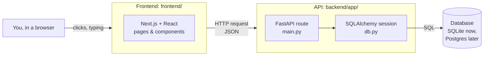

# Architecture overview

Gyst has three layers. Each one has a single job, and each one only talks to
its neighbor.

| Layer | Folder | Job | Tech |
|---|---|---|---|
| **Frontend** | `frontend/` | Show things and react to the user. Owns *no* permanent data. | Next.js, React, TypeScript, Tailwind |
| **API** | `backend/app/` | The rules: validate input, decide what's allowed, read/write data. | Python, FastAPI |
| **Data access** | `backend/app/db.py`, `models.py` | Translate Python objects ↔ database rows. | SQLAlchemy, Alembic |
| **Database** | `backend/gyst.db` (local) | Store data permanently. | SQLite → PostgreSQL |

## Why separate layers?

- **The frontend can't talk to the database directly.** The API is the
  gatekeeper, so rules (e.g. "a supporting goal has at most 8 tasks") live in
  one place and can't be bypassed.
- **Each layer can change on its own.** Swapping SQLite for Postgres touches
  only the data layer; redesigning a page touches only the frontend.

## Life of a request (what a future feature will look like)

Example: the user checks off a task on the "today" page.

1. **Browser → Frontend.** The user clicks a checkbox. A React component
   (`frontend/src/...`) handles the click.
2. **Frontend → API.** The component sends an HTTP request, e.g.
   `PATCH http://localhost:8000/tasks/42` with JSON `{"done": true}`.
3. **API route.** FastAPI matches the URL to a Python function (a *route*),
   validates the JSON against a schema, and asks for a DB session via
   `Depends(get_db)`.
4. **API → Database.** The route loads `Task` 42 through SQLAlchemy, sets
   `done = True`, and commits. SQLAlchemy writes the SQL (`UPDATE tasks ...`).
5. **Back up the chain.** The API returns the updated task as JSON; the
   React component updates what's on screen.

Every feature follows this same path, built **bottom-up**: model + migration
→ API route + tests → UI. See [features/README.md](../features/README.md).

## Current state

- Frontend and API both run, but **are not connected yet**. Connecting them
  (CORS, an API base URL, a first fetch) is the first step of PR #2.
- The API has one route: `GET /health`.
- The data layer is configured but has **no tables**.

See also: [database.md](database.md).
